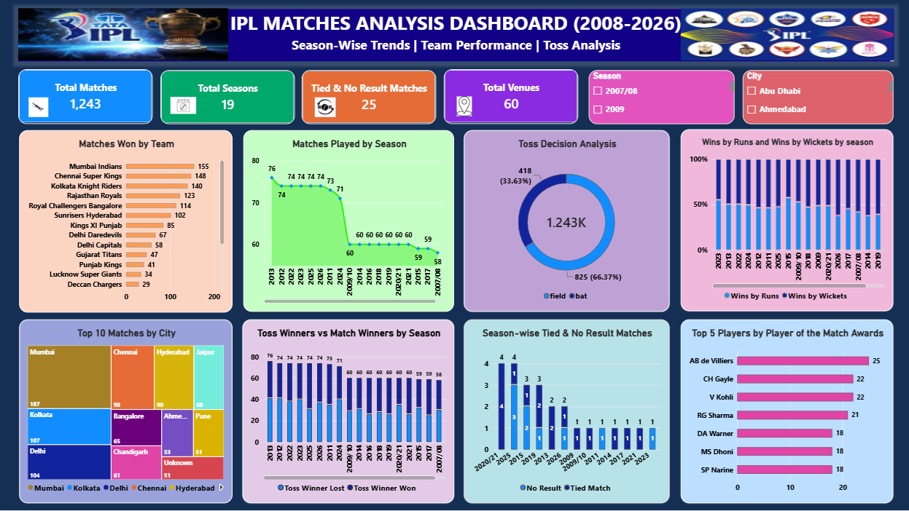

# IPL Matches Analysis Dashboard (2008-2026)

Interactive Power BI dashboard analyzing IPL matches across seasons, covering season-wise trends, team performance and toss analysis.

**[View the dashboard (PDF)](ipl-dashboard.pdf)**

## Tools Used
Power BI, Data Modeling, Data Visualization

## Dashboard Highlights
- KPI cards: 1,243 total matches, 19 seasons, 60 venues, and 25 tied/no-result matches
- Matches played and tied/no-result matches by season
- Matches won by each team (Mumbai Indians lead with 155 wins)
- Top 5 players by Player of the Match awards
- Toss decision analysis and toss winners vs match winners
- Top 10 cities by matches hosted
- Wins by runs vs wickets across seasons
- Season and city slicers for interactive filtering

## Data Source
IPL 2008-2026 Matches Dataset (1,243 matches, 31 features) by arjunsinghgangwar on Kaggle, used under the MIT license.
https://www.kaggle.com/datasets/arjunsinghgangwar/ipl-20082026-matches-dataset

## Files
- `ipl-dashboard.pbix`: Power BI project file (open in Power BI Desktop)
- `ipl-dashboard.pdf`: dashboard export (view in browser)
- `dashboard-overview.png`: dashboard screenshot
- `ipl-matches-dataset.csv`: source data (from Kaggle)

## Author
L Vaishnavi
